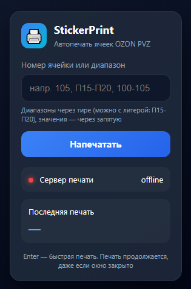
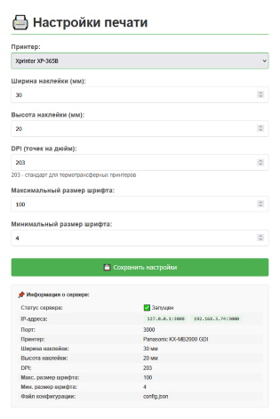

# 🖨️ StickerPrint

> Расширение для Chrome + локальный сервер печати, которые **автоматически печатают номерки ячеек** при размещении товаров в Ozon PVZ (Turbo-PVZ).




---

## ✨ Возможности

- 🎯 **Автопечать при размещении** — номерок печатается в двух сценариях: когда товар **кладётся в ячейку** (`Movement/put/v2`) и когда товару **присваивается полка** (`TransferByBarcodeArticle`, например `"Ozon Полка-88"` → `П88`).
- ⌨️ **Ручная печать** — ввести номер через всплывающее окно расширения.
- 📚 **Серийная печать диапазонов** — например `100-105, П15-П20` (до 1000 ячеек за раз).
- 🛑 **Отмена с прогрессом** — печать продолжается даже при закрытом popup, прогресс виден в реальном времени.
- ⚙️ **Веб-настройки** — выбор принтера, размер этикетки, DPI, размер шрифта через браузер.
- 🖥️ **Иконка в трее** — быстрый доступ к настройкам.
- 🧠 **Устойчивость к перезапускам** — если Chrome выгрузит service worker, печать продолжится с места остановки.

---

## 🧭 Как это работает

```
┌─────────────────────┐         ┌──────────────────┐         ┌─────────────────┐
│  turbo-pvz.ozon.ru  │         │   Расширение     │         │  Локальный      │
│                     │         │   (Chrome MV3)   │         │  сервер печати  │
│  page-hook.js (MAIN)│──msg───▶│ content.js       │────────▶│  Flask :3000    │
│  перехват XHR       │         │ background.js    │  HTTP   │  win32print     │
│                     │         │ popup.js         │         │  → принтер      │
└─────────────────────┘         └──────────────────┘         └─────────────────┘
```

`page-hook.js` работает в MAIN-мире страницы и перехватывает XHR-ответы Turbo-PVZ. Печать запускается в **двух** сценариях размещения:

| Эндпоинт | Что происходит на сайте | Что берём | Печать |
|---|---|---|---|
| `/api2/address-storage/Movement/put/v2` | Товар **кладётся в ячейку** | `articlePositions[0].address` | ✅ **да** |
| `.../MicroFFTransferApi/TransferByBarcodeArticle` | Товару **присваивается полка** (например `"Ozon Полка-88"` → `П88`) | `transferSuccess.cell` | ✅ **да** |

Найденный номер через `content.js` уходит в `background.js`, который отправляет `POST /print` на локальный сервер. Сервер печатает номерок на термопринтере.

Подробности — в комментариях к исходникам.

---

## 🛠️ Установка

### 1. Требования

- **Windows** 10/11 (сервер использует `win32print`)
- **Python** 3.9+
- **Google Chrome** (или Chromium-based браузер)
- **Термопринтер** с установленным драйвером (Xprinter, Zebra, Godex и т.п.)

### 2. Настройка сервера печати

```bash
# Перейти в папку сервера
cd server

# Создать виртуальное окружение
python -m venv .venv
.venv\Scripts\activate

# Установить зависимости
pip install -r requirements.txt

# Запустить сервер
python server.py
```

Сервер запускается на значениях по умолчанию «из коробки». Файл `config.json` создаётся автоматически при **первом сохранении настроек** через веб-интерфейс — заранее готовить его не нужно.

После запуска:

- 🌐 Веб-настройки: http://localhost:3000/settings
- 🔍 Проверка сервера: http://localhost:3000/
- 🖥️ Иконка в системном трее

В настройках выбери принтер, укажи размер этикетки и DPI (обычно **203** или **300**). Если ничего не выбирать — будет использован **системный принтер по умолчанию**.

### 3. Установка расширения

1. Открой `chrome://extensions/`
2. Включи **«Режим разработчика»** (справа сверху)
3. Нажми **«Загрузить распакованное расширение»**
4. Выбери **папку `extension/`** из этого репозитория (⚠️ именно `extension/`, а не корень проекта)
5. Готово! Иконка 🖨️ появится в панели браузера

---

## 🚀 Использование

### Автопечать при размещении (основной режим)

Просто работай в Turbo-PVZ как обычно. Номерок распечатается автоматически:

- когда товар **кладётся в ячейку** (`Movement/put/v2`);
- когда товару **присваивается полка** (`TransferByBarcodeArticle`).

### Ручная печать

1. Нажми иконку расширения 🖨️
2. Введи номер: `105`, `П15`, `A1` и т.д.
3. Нажми **Enter** или кнопку «Напечатать»

### Серийная печать

В поле ввода можно вводить диапазоны:

| Ввод | Что напечатается |
|---|---|
| `105` | `105` |
| `100-105` | `100, 101, 102, 103, 104, 105` |
| `П15-П20` | `П15, П16, П17, П18, П19, П20` |
| `А50-60` | `А50, А51, …, А60` |
| `П1-П3, А5, 200` | `П1, П2, П3, А5, 200` |
| `П008-П012` | `П008, П009, П010, П011, П012` (ведущие нули) |

Ограничение: **до 1000 ячеек** за один запуск.

---

## ⚙️ Настройки сервера (справочно)

Сервер работает на значениях по умолчанию «из коробки». Файл `config.json` создаётся автоматически при **изменении настроек** через веб-интерфейс. Вот что он хранит:

```json
{
    "label_width_mm": 30,
    "label_height_mm": 20,
    "dpi": 203,
    "max_font_size": 100,
    "min_font_size": 4,
    "printer_name": ""
}
```

| Параметр | Описание |
|---|---|
| `label_width_mm` | Ширина этикетки в мм |
| `label_height_mm` | Высота этикетки в мм |
| `dpi` | Разрешение принтера (203 — стандарт для термопринтеров) |
| `max_font_size` | Максимальный размер шрифта |
| `min_font_size` | Минимальный размер шрифта |
| `printer_name` | Имя принтера. **Пустая строка** (или принтер, которого нет в системе) = используется **системный принтер по умолчанию** |

Менять файл вручную не нужно — используй веб-интерфейс http://localhost:3000/settings.

---

## 📸 Скриншоты

| Попап расширения | Настройки сервера |
|---|---|
|  |  |

---

## 🔒 Безопасность

- Всё работает **локально**. Расширение обращается только к `127.0.0.1:3000`.
- Никакие данные не отправляются на сторонние серверы.
- Разрешения расширения: `storage` (настройки), `alarms` (watchdog), доступ к `turbo-pvz.ozon.ru` и `127.0.0.1:3000`.

---

## 🧩 Структура проекта

```
sticker-print/
│
├── extension/                  # 🧩 Chrome-расширение (Manifest V3)
│   ├── manifest.json           # манифест: разрешения, точки входа, мир скриптов
│   ├── background.js           # service worker: очередь печати, watchdog
│   ├── content.js              # мост: слушает page-hook → шлёт в background
│   ├── page-hook.js            # перехват XHR в MAIN-мире (put/v2, полка)
│   ├── popup.html              # разметка попапа (UI расширения)
│   ├── popup.js                # логика UI: парсинг диапазонов, прогресс
│   └── icon.png                # иконка расширения (16/48/128)
│
├── server/                     # 🖨️ Локальный сервер печати (Python)
│   ├── server.py               # Flask :3000 + win32print + иконка в трее
│   └── requirements.txt        # зависимости Python (Flask, pywin32, pystray, Pillow)
│
├── docs/                       # 🖼️ картинки для README
│   ├── popup.png               # скриншот попапа расширения
│   └── settings.png            # скриншот страницы /settings
│
├── .gitignore                  # что не коммитить (config.json, venv, __pycache__)
├── README.md                   # этот файл — описание проекта
└── LICENSE                     # лицензия MIT
```

> 💡 `config.json` создаётся автоматически при **изменении настроек** и **не хранится в репозитории** (он в `.gitignore`).

---

## ❓ FAQ

**Печать не работает / сервер offline**
→ Убедись, что `python server.py` запущен, и в настройках выбран принтер (или есть системный по умолчанию).

**Номерки печатаются дважды**
→ Проверь `lastPrintedCell` в консоли service worker. Возможно, страница отправляет дублирующие запросы.

**Расширение не устанавливается**
→ Проверь, что выбираешь папку `extension/`, а в ней на верхнем уровне лежит `manifest.json`.

**Принтер не виден в настройках**
→ Принтер должен быть установлен в системе (Панель управления → Устройства → Принтеры). Если в настройках ничего не выбрано, сервер использует **системный принтер по умолчанию**.

**Где взять `config.json`?**
→ Не нужно нигде брать. Сервер работает на дефолтных значениях «из коробки», а `config.json` создастся сам, как только ты сохранишь настройки через http://localhost:3000/settings.

---

## 📄 Лицензия

MIT — можно свободно использовать, форкать и модифицировать.

---

## 🙏 Благодарности

Проект создан для упрощения работы сотрудников ПВЗ Ozon. Не является официальным продуктом Ozon.